<div align="center">

# Claude Token Cost Optimizer

### Cut your Claude API bill by up to 91% with caching, batching, compaction and routing, with the math to prove it


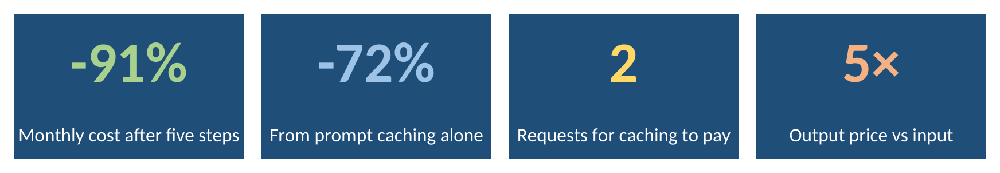

</div>

> Every chart below is a **native Excel chart** from [`excel/claude_token_costs.xlsx`](excel/claude_token_costs.xlsx). Change any blue input cell and every table and chart updates.

## Contents

- [The problem](#the-problem)
- [Key results](#key-results)
- [Tokens in five minutes](#tokens-in-five-minutes)
- [How the Claude API bills you](#how-the-claude-api-bills-you)
- [The math](#the-math)
- [A chat, turn by turn](#a-chat-turn-by-turn)
- [Prompt caching in depth](#prompt-caching-in-depth)
- [Batch API in depth](#batch-api-in-depth)
- [14 practical ways to spend fewer tokens](#14-practical-ways-to-spend-fewer-tokens)
- [A prompt layout that caches well](#a-prompt-layout-that-caches-well)
- [Which saving should I use?](#which-saving-should-i-use)
- [Result gallery](#result-gallery)
- [Using the Excel workbook](#using-the-excel-workbook)
- [Run it](#run-it)
- [Project layout](#project-layout)
- [FAQ](#faq)
- [Glossary](#glossary)
- [Limits](#limits)
- [ملخص بالعربي](#ملخص-بالعربي)

## The problem

The Claude API is stateless, so a chat resends its **whole history on every turn**. Cost per turn grows with the turn number, and cost per chat grows with its square. Most of the bill is text the model has already seen.

| Where the tokens go | Where the money goes |
|---|---|
| 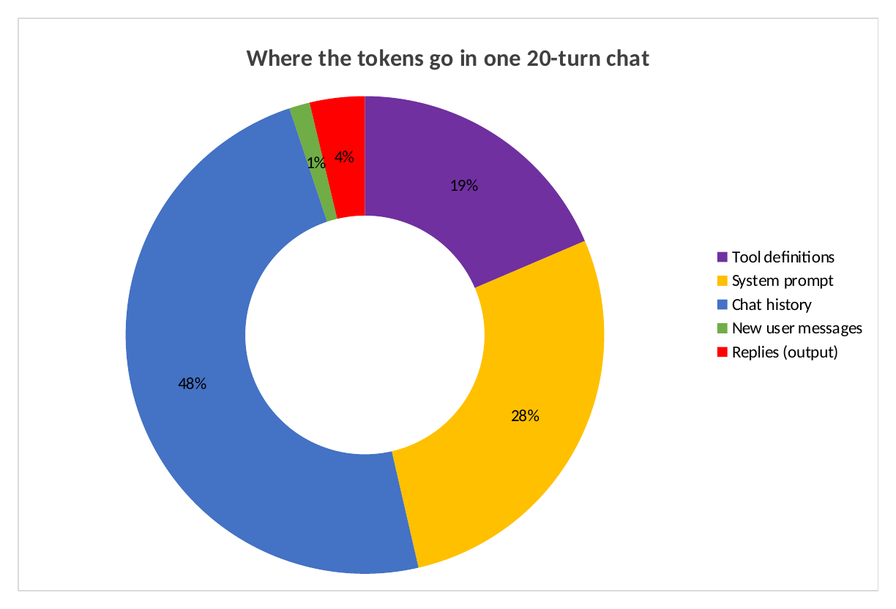 | 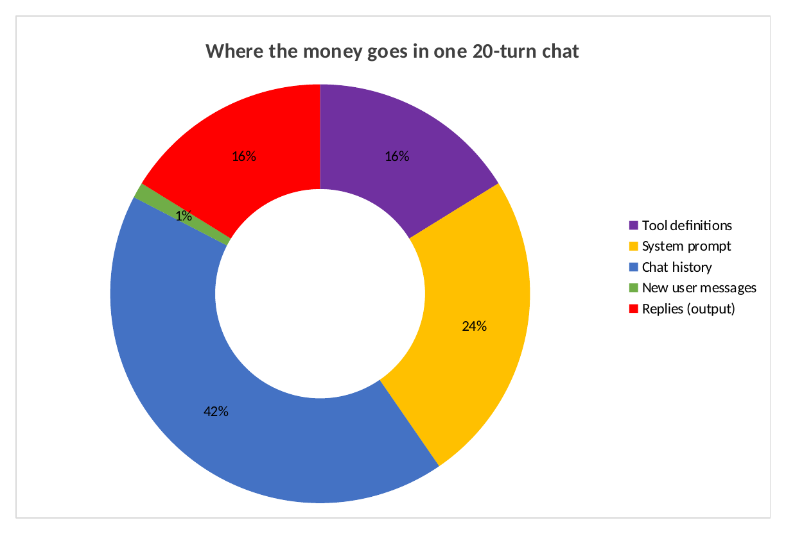 |

In one 20-turn support chat, history, tools and the system prompt make up **95% of the tokens**. Replies are only 4% of tokens, but **16% of the cost**, because output costs 5× input.

## Key results

Scenario: a support chatbot on Claude Sonnet 5.5, with 2,000 tokens of tool definitions, a 3,000-token system prompt, 150-token questions, 400-token replies, 20 turns per chat and 1,000 chats a day.

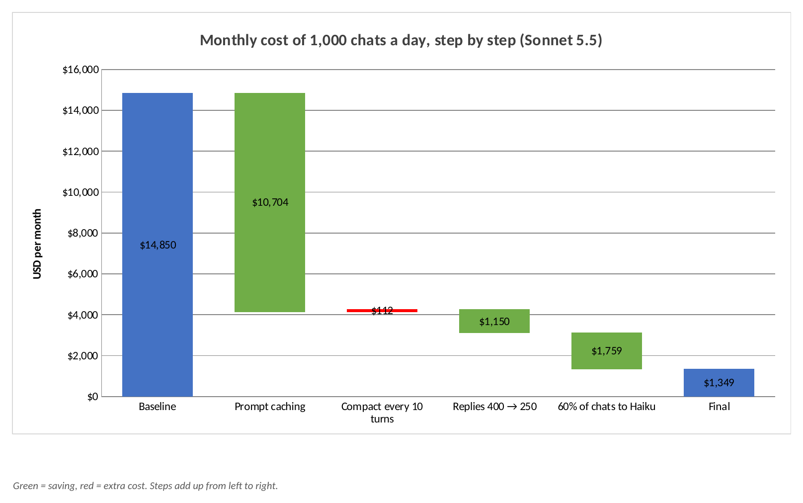

| Step | USD per month | Change |
|---|---:|---:|
| Baseline | 14,850 | |
| + Prompt caching | 4,146 | **−72%** |
| + Compact history every 10 turns | 4,258 | +3% |
| + Shorter replies, 400 → 250 tokens | 3,108 | −27% |
| + Send 60% of chats to Haiku 5.5 | **1,349** | −57% |

What this shows:

- **Prompt caching is the biggest single win**, at 72% off, and needs no change to what the model sees.
- **Compaction did not pay at 20 turns:** it cost 3% more, because the summary call and the cache rewrite cost more than they saved. Over 40 turns it is slightly cheaper.
- **A sliding window and caching fight each other.** Dropping old turns changes the prefix, so the cache misses. Over 40 turns, caching alone costs $287 per 1,000 chats, and caching with a 6-turn window costs $486.
- **The 5-minute cache pays from the 2nd request, and the 1-hour cache from the 3rd.**
- Routing to Haiku 5.5 saves the most of all, but only if its answers are good enough for the task.

## Tokens in five minutes

A **token** is the unit a language model reads and writes. It is usually a piece of a word: a common English word is often one token, while a rare word, a number or a word in another script can split into several. The exact split depends on the model's tokenizer.

Three facts matter for your bill:

1. **You pay per token, not per word or per request.** A long prompt costs more even if the answer is short.
2. **Tokenizers differ between models.** Anthropic's docs note that Claude Fable 5.1, Mythos 5.1, Fable 5 and Mythos 5 use a newer tokenizer, so the same prompt counts roughly 30% higher than on models before Claude Opus 4.7. Always count against the model you will use.
3. **The model has no memory between requests.** Everything it needs, including the chat so far, is sent again every time. That is why history becomes the largest part of the bill.

To count tokens exactly, use the official `count_tokens` endpoint. It is free, with its own rate limit, and `count_tokens.py` in this repository calls it for you. Anthropic describes the count as an estimate that can differ slightly from the final billed amount.

## How the Claude API bills you

Every request is billed in up to five token categories:

| Category | What it is | Price relative to input |
|---|---|---:|
| Input | Normal prompt tokens | 1× |
| Cache write, 5 minutes | Prompt tokens stored for later reuse | 1.25× |
| Cache write, 1 hour | Stored for longer | 2× |
| Cache read | Tokens reused from the cache | 0.1× on most models, 0.05× on Opus 5.5 and Sonnet 5.5, 0.025× on Fable 5.1 and Mythos 5.1 |
| Output | Tokens the model writes | 5× on every model listed |

Discounts stack: the **Batch API** halves every category, and caching multipliers apply on top of it.

**Example, one request on Sonnet 5.5:** a 10,000-token prompt with a 500-token answer costs
10,000 × $2 / 1M + 500 × $10 / 1M = $0.020 + $0.005 = **$0.025**.
If 9,500 of those prompt tokens come from the cache, the input part becomes
9,500 × $0.10 / 1M + 500 × $2.50 / 1M = $0.00095 + $0.00125 = $0.0022, and the request costs **$0.0072**, or 71% less.

## The math

**Cost of one request.** All prices are in USD per million tokens:

$$C = \frac{N_{in}\,p_{in} + N_{w}\,p_{w} + N_{r}\,p_{r} + N_{out}\,p_{out}}{10^6}$$

**History grows quadratically.** With a fixed prefix $S$, user message $u$ and reply $a$, the input tokens over $T$ turns are:

$$N_{in}(T) = \sum_{t=1}^{T}\big(S + (t-1)(u+a) + u\big) = T(S+u) + (u+a)\frac{T(T-1)}{2}$$

**With caching**, turn $t$ reads the previous prompt and writes only the new part:

$$N_r(t) = S + (t-2)(u+a) + u, \qquad N_w(t) = u + a$$

**Break-even for caching.** A prefix of $P$ tokens shared by $n$ requests, with write multiplier $w$ and read multiplier $r$:

$$\underbrace{n\,P\,p}_{\text{no cache}} \;>\; \underbrace{w\,P\,p + (n-1)\,r\,P\,p}_{\text{cache}} \iff n > \frac{w-r}{1-r}$$

For Sonnet 5.5 ($r = 0.05$): 5-minute cache ($w = 1.25$) pays from $n = 2$, and 1-hour cache ($w = 2$) from $n = 3$.

**Batch API** multiplies every price by 0.5, and it stacks with caching.

## A chat, turn by turn

The support chat from the key results, on Sonnet 5.5, priced by `tokenopt/simulate.py`:

| Turn | Prompt tokens | Cost, no cache | Cache read | Cache write | Cost, with cache |
|---:|---:|---:|---:|---:|---:|
| 1 | 5,150 | $0.0143 | 0 | 5,150 | $0.0169 |
| 2 | 5,700 | $0.0154 | 5,150 | 550 | $0.0059 |
| 10 | 10,100 | $0.0242 | 9,550 | 550 | $0.0063 |
| 20 | 15,600 | $0.0352 | 15,050 | 550 | $0.0069 |
| **Whole chat** | 207,500 input | **$0.495** | | | **$0.138** |

Read it like this:

- **Turn 1 is slightly more expensive with caching,** because writing to the cache costs 1.25×.
- **From turn 2 on, almost the whole prompt is a cache read,** so each turn costs about the same no matter how long the chat is.
- Without caching, turn 20 costs 2.5× turn 1. With caching, it costs about 1.2× turn 2.

## Prompt caching in depth

Facts below come from the [prompt caching docs](https://platform.claude.com/docs/en/build-with-claude/prompt-caching).

**How it works.** You mark a point in the prompt with `cache_control`. Claude stores everything up to that point. A later request that starts with exactly the same content reads it from the cache instead of processing it again.

**Order matters.** The cache follows the order **tools → system → messages**. A change at one level clears that level and everything after it:

| If you change… | What is lost |
|---|---|
| Tool definitions | The whole cache |
| Web search, citations or speed setting | System and messages |
| Tool choice, or adding or removing images | Messages only |
| Thinking settings or effort | Messages, and on some models more |
| Any text before a breakpoint | Everything after that point |

**Other rules:**

- **Lifetime:** 5 minutes by default, refreshed free each time the entry is used. A 1-hour option costs 2× to write.
- **Up to 4 breakpoints** per prompt. Breakpoints themselves cost nothing.
- **Minimum size:** 512 tokens on the newest models (Fable 5.1, Mythos 5.1, Opus 5.5, Sonnet 5.5, Haiku 5.5), and up to 4,096 on some older ones. Shorter prompts are simply not cached, with no error.
- **Check it worked:** the response reports `cache_creation_input_tokens` and `cache_read_input_tokens`. If both are 0, nothing was cached.

**5 minutes or 1 hour?** Take a 10,000-token prefix used 4 times, 20 minutes apart, on Sonnet 5.5:

| Option | What happens | Cost |
|---|---|---:|
| No cache | 4 normal reads | $0.080 |
| 5-minute cache | Expires every time, so 4 writes | $0.100 |
| 1-hour cache | 1 write and 3 reads | **$0.043** |

If requests are more than 5 minutes apart, the 5-minute cache costs **more** than no cache at all.

## Batch API in depth

Facts below come from the [batch processing docs](https://platform.claude.com/docs/en/build-with-claude/batch-processing).

- **50% off** input and output, for work that does not need an instant answer.
- Results arrive when all requests finish or after **24 hours**, whichever comes first. Anthropic says most batches finish **in under an hour**.
- A batch holds up to **100,000 requests or 256 MB**.
- Caching works inside batches, but hits are **best effort**. Anthropic reports hit rates of **30% to 98%**. Identical `cache_control` blocks in every request, and the 1-hour cache, help.

Good fits: classifying documents, summarizing archives, generating test data, translating a catalogue, nightly reports.

## 14 practical ways to spend fewer tokens

**Structure, so the cache keeps working**

1. **Put stable content first:** tools, then the system prompt, then reference documents, then the chat. Changing content goes last.
2. **Keep the system prompt fixed.** A timestamp, user name or random ID inside it changes the prefix on every request, so the cache never hits. Put such details in the latest user message.
3. **Do not edit tool definitions mid-session.** Any change clears the whole cache.
4. **Use the 1-hour cache when requests are more than 5 minutes apart.**
5. **Check `cache_read_input_tokens` in responses.** A cache that silently misses is the most common reason savings do not appear.

**Size, so there is less to pay for**

6. **Trim tool definitions.** Every tool's name, description and schema are sent on every request. Remove tools the task does not need.
7. **Shorten the system prompt.** Remove repeated rules and long examples the model does not need.
8. **Send only the documents the task needs,** not a whole folder. Search first, then send the relevant parts.
9. **Ask for the length you need,** and set `max_tokens`. Output costs 5× input.
10. **Prefer structured answers** such as a short JSON object or a table when you will process the answer by code.

**History, so long chats stay affordable**

11. **Compact rarely, not every turn.** In this study, compacting every 10 turns cost 3% more at 20 turns and saved only a little at 40. Compaction pays in very long sessions.
12. **Avoid a sliding window when caching is on.** Dropping the oldest turn changes the prefix and breaks the cache.

**Routing and scheduling**

13. **Send easy tasks to a smaller model,** such as Haiku 5.5, after checking that its answers are good enough.
14. **Use the Batch API for anything that can wait.**

## A prompt layout that caches well

```text
[tools]                      fixed for the whole session
[system prompt]              fixed: role, rules, output format       <- breakpoint 1
[reference documents]        fixed for this session                  <- breakpoint 2
[conversation so far]        grows by one turn each request          <- breakpoint 3 (latest message)
[new user message]           the only part that changes
```

And a system prompt written to keep answers short:

```text
You are a support assistant for <product>.
Answer in at most 5 sentences unless the user asks for more.
When the answer is a list of steps, use a numbered list with no introduction.
If you need information you do not have, ask one short question.
```

## Which saving should I use?

<p align="center">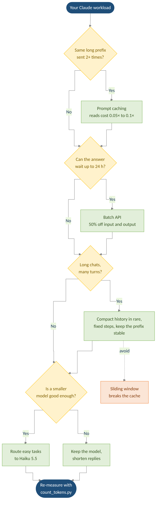</p>

## Result gallery

### Why chats get expensive

| Cost of each turn | 40 turns, five strategies |
|---|---|
| 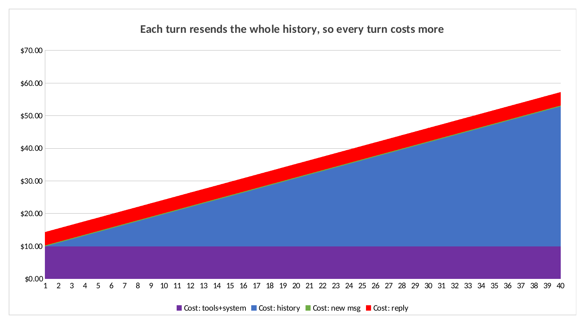 | 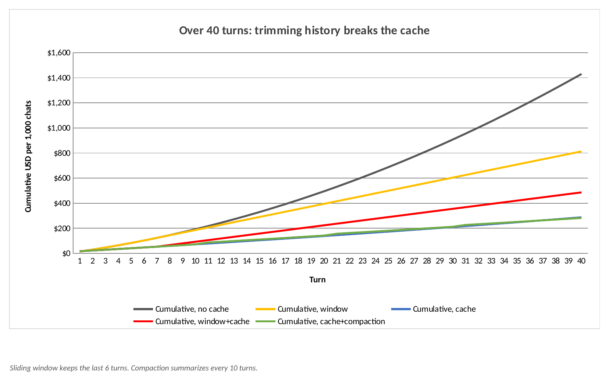 |

### Caching

| When caching pays off | Saving by prefix size and reuse |
|---|---|
| 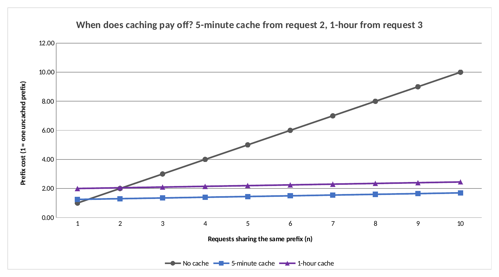 | 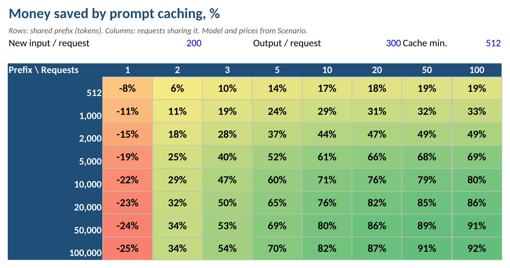 |

Caching loses money only when a prefix is used once, because writing costs 1.25×. With a 100,000-token prefix shared by 100 requests, it saves 92%.

### Models and batch jobs

| Same chat on each model | Claude price map |
|---|---|
| 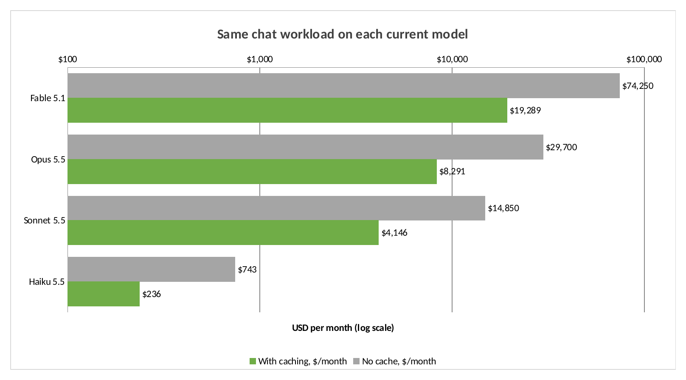 | 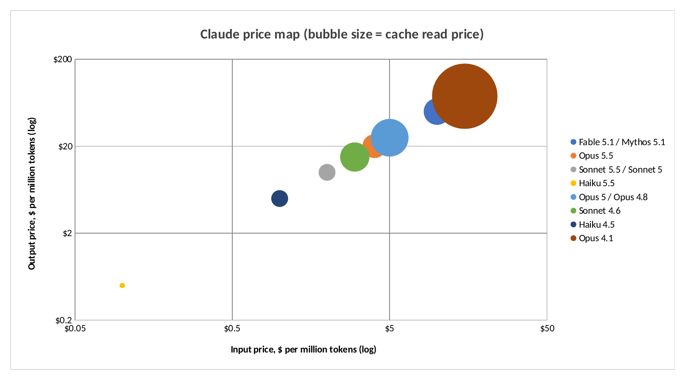 |

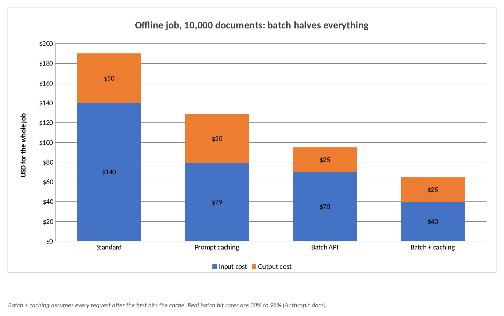

An offline job of 10,000 documents drops from $190 to $95 with the Batch API and to $65 with batch plus caching. Cache hits inside batches are best effort, and the docs report 30% to 98%, so the last bar is an upper bound.

### Prices used

| Model | Input | 5-min write | 1-hour write | Cache read | Output |
|---|---:|---:|---:|---:|---:|
| Fable 5.1 | $10 | $12.50 | $20 | $0.25 | $50 |
| Opus 5.5 | $4 | $5 | $8 | $0.20 | $20 |
| Sonnet 5.5 | $2 | $2.50 | $4 | $0.10 | $10 |
| Haiku 5.5, prompts up to 100k tokens | $0.10 | $0.125 | $0.20 | $0.01 | $0.50 |

USD per million tokens, from the [official pricing page](https://platform.claude.com/docs/en/about-claude/pricing), retrieved 9 November 2026. Prices change, so check the source.

## Using the Excel workbook

Open [`excel/claude_token_costs.xlsx`](excel/claude_token_costs.xlsx) in Excel or LibreOffice.

| Sheet | What it holds |
|---|---|
| Overview | The four headline numbers |
| Scenario | **Your inputs** in blue: model, token sizes, chats per day |
| Prices | Official prices, editable when they change |
| Chart sheets | One native Excel chart each |
| Cache Savings | Heatmap built with conditional formatting |
| Per Turn | 40 turns, every token and cost, all formulas |
| Data sheets | The tables behind each chart |

Try this: set the model in `Scenario!B3` to `Claude Opus 5.5`, or change chats per day in `Scenario!B9`. Every chart updates. Three waterfall steps and the compaction line come from the Python simulator and are marked with a comment, because compaction needs a turn-by-turn run.

## Run it

```bash
pip install -r requirements.txt

# Compare strategies for your own workload
python optimize.py workloads/support_chatbot.json
python optimize.py workloads/coding_agent.json

# Rebuild everything: numbers, Excel workbook, chart images
python run_analysis.py
python build_excel.py
python render_excel_charts.py     # needs LibreOffice

# Exact token count with your own key (free endpoint)
python count_tokens.py my_prompt.txt --model claude-sonnet-5-5 --name "Claude Sonnet 5.5"

pytest tests
```

Example output of `optimize.py` for the coding agent workload (Opus 5.5, 40 turns, 200 sessions a day):

```text
Option                                     USD / month    Saving
Caching on Haiku 5.5                            779.52     98.9%
Caching + compaction every 10 turns          11,010.12     84.5%
Prompt caching                               12,510.24     82.4%
Caching + sliding window (6 turns)           24,948.60     65.0%
Sliding window (6 turns), no caching         34,831.20     51.1%
As is                                        71,184.00      0.0%
```

## Project layout

```text
tokenopt/pricing.py          Official prices and cache minimums
tokenopt/cost.py             Cost of one request, break-even formula
tokenopt/simulate.py         Turn-by-turn chat simulator with caching
run_analysis.py              Runs the studies, writes results/summary.json
build_excel.py               Builds the workbook with formulas and Excel charts
render_excel_charts.py       Exports the Excel charts as PNG
optimize.py                  Strategy comparison for your workload
count_tokens.py              Exact counts through the official API
workloads/                   Example workloads
excel/claude_token_costs.xlsx
```

## FAQ

**Does caching change the answer?**
No. A cache read gives the model the same prompt. Only the price and speed change.

**Why did compaction cost more in the main example?**
Compaction makes an extra request to write the summary, and the shortened history has to be written to the cache again. With only 20 turns, those costs were larger than the savings.

**Is the 91% saving guaranteed?**
No. It is a calculation for one example workload. Your saving depends on your prompt sizes, your traffic and how often requests share a prefix. Put your own numbers in `workloads/` or the Excel `Scenario` sheet.

**Why is output so expensive?**
Output costs 5× input on every model in the price table. In a typical chat, output is a small share of tokens but a large share of cost.

**Do these prices apply on Bedrock or Google Cloud?**
The docs list a 10% premium for regional endpoints on those platforms, and data residency adds 10% on newer models. This project uses the standard global prices.

## Glossary

| Term | Meaning |
|---|---|
| Token | The unit of text a model reads and writes |
| Prompt | Everything sent to the model in one request |
| Prefix | The start of the prompt that stays the same between requests |
| Breakpoint | The point marked with `cache_control` where the cache ends |
| Cache hit | A request that reads its prefix from the cache |
| TTL | Time to live: how long a cache entry lasts |
| Compaction | Replacing old history with a short summary |
| Sliding window | Keeping only the most recent turns |
| Routing | Sending each task to the cheapest model that handles it well |
| MTok | One million tokens, the unit prices are quoted in |

## Limits

- **These are cost calculations, not measured bills.** Token sizes are assumptions for a typical workload. Use `count_tokens.py` to measure yours.
- Caching assumes each turn arrives within the 5-minute cache lifetime.
- Shorter replies and routing to Haiku are what-if settings. Their effect on answer quality was not measured.
- Compaction assumes a 600-token summary, and its quality was not measured.
- `count_tokens.py` was not run here, because no API key was used to build this project.

## Author

**Jaafar Salim**, University of Technology, Iraq

## ملخص بالعربي

<div dir="rtl">

هذا المشروع يحسب شكد تكلف محادثات Claude API وشلون تقللها، بأسعار رسمية ومعادلات وملف Excel حي.

- **المشكلة:** النموذج ما يتذكر، فكل دور بالمحادثة يرسل كل الكلام السابق من جديد، والكلفة تكبر مع مربع عدد الأدوار.
- **أقوى حل:** التخزين المؤقت للبرومت يقلل الكلفة 72% بالمثال، ويبدي يربح من الطلب الثاني.
- **انتبه:** حذف الرسائل القديمة يكسر التخزين المؤقت، فيصير أغلى.
- **الدفعات:** خصم 50% للشغل اللي يكدر ينتظر.
- **النتيجة:** من 14,850 إلى 1,349 دولار بالشهر بالمثال، يعني 91% أقل.

الأرقام حسابات لمثال، مو فواتير حقيقية. غيّر أرقامك بملف Excel وشوف النتيجة.

</div>
